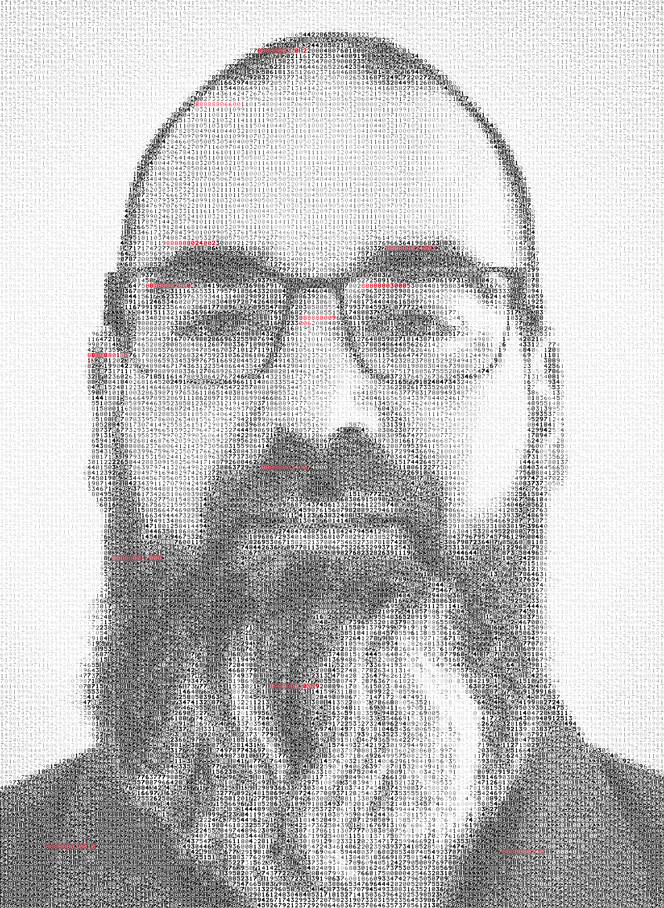

# TWENTY PROOFS

**[English](#english) · [Français](#français)**

**[View full-resolution portrait](https://raw.githubusercontent.com/Sd-tech-Sol/twenty-proofs/main/twenty-proofs-portrait.png)** · **[Download original PNG](https://github.com/Sd-tech-Sol/twenty-proofs/releases/download/portrait-v1/twenty-proofs-portrait.png)**

**[Voir le portrait en pleine résolution](https://raw.githubusercontent.com/Sd-tech-Sol/twenty-proofs/main/twenty-proofs-portrait.png)** · **[Télécharger le PNG original](https://github.com/Sd-tech-Sol/twenty-proofs/releases/download/portrait-v1/twenty-proofs-portrait.png)**

---

## English

### A portrait. Thousands of digits. Twenty challenges.

At first glance, it is an ordinary portrait. Look closer: it is built entirely from numbers.

Some of those numbers are different.

That is where the investigation begins.

TWENTY PROOFS is a free cryptographic puzzle that calls on logic, programming, cryptography, digital forensics and plain problem-solving.

No registration. No payment. Just the challenge.

**Start with the original image, in full resolution.**

| | |
|---|---|
| Format | PNG, lossless |
| Size | 2240 × 3060 pixels |
| SHA-256 | `8371d9c7f1b2e61aab91dd34574cd1e74f3e965fecdbab7dc5d4a623ebad5f04` |

Always work from the original PNG. Previews, screenshots and resized copies do not carry the same information.

---

## Français

### Un portrait. Des milliers de chiffres. Vingt épreuves.

Au premier regard, c'est un portrait ordinaire. Regardez de plus près : il est entièrement construit à partir de chiffres.

Certains de ces chiffres sont différents.

C'est là que commence l'enquête.

TWENTY PROOFS est une énigme cryptographique gratuite qui fait appel à la logique, à la programmation, à la cryptographie, à l'investigation numérique et à la résolution de problèmes.

Aucune inscription. Aucun paiement. Seulement le défi.

**Commencez par l'image originale, en pleine résolution.**

| | |
|---|---|
| Format | PNG, sans perte |
| Dimensions | 2240 × 3060 pixels |
| SHA-256 | `8371d9c7f1b2e61aab91dd34574cd1e74f3e965fecdbab7dc5d4a623ebad5f04` |

Travaillez toujours à partir du PNG original. Les aperçus, captures d'écran et copies redimensionnées ne contiennent pas les mêmes informations.

---

© 2026 Sébastien Dubé. The portrait may be downloaded and analysed freely to play TWENTY PROOFS; all other rights reserved. · Le portrait peut être téléchargé et analysé librement pour jouer à TWENTY PROOFS; tous les autres droits sont réservés.
